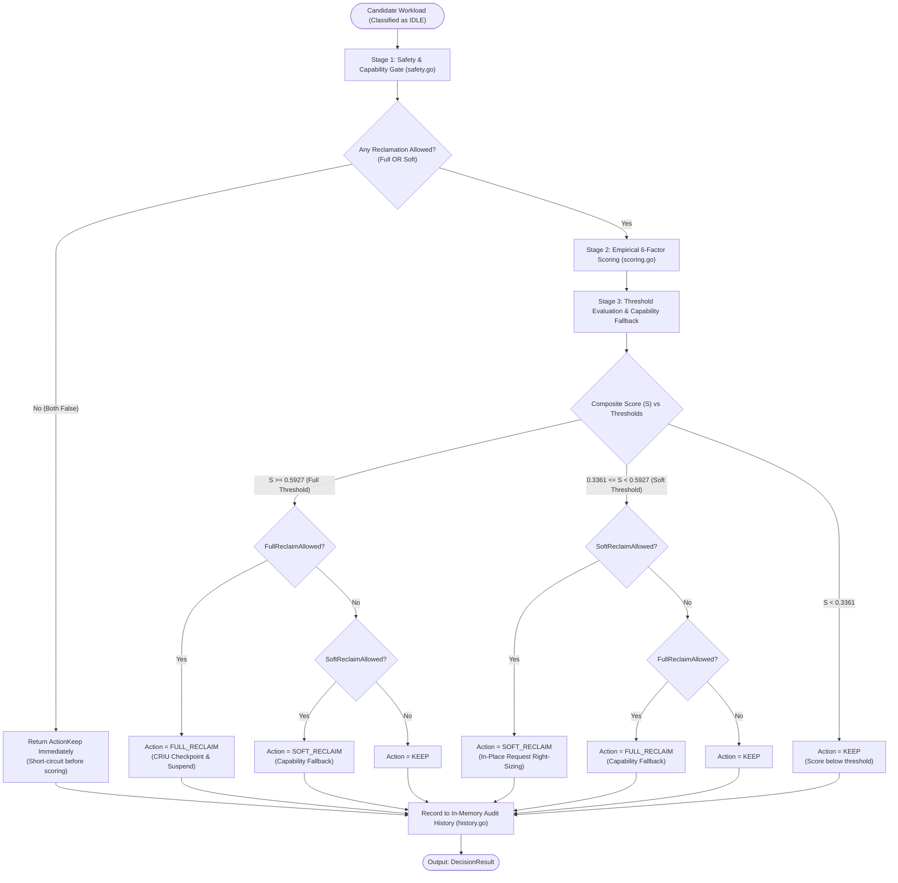

# Architecture Specification: Multi-Criteria Reclamation Decision Engine

This document provides a comprehensive architectural specification of the **Multi-Criteria Reclamation Decision Engine** implemented in `adaptive-k8s-scheduler/pkg/decision`.

---

## 1. Executive Summary & System Role

The **Reclamation Decision Engine** is the terminal decision-making component of the intelligence pipeline in the Adaptive Kubernetes Scheduler. 

### Core Architectural Principle: Decider vs. Executor Separation
- The Decision Engine is purely an **evaluator and decider**. It determines **what** action should be taken (`KEEP`, `SOFT_RECLAIM`, or `FULL_RECLAIM`) and provides full explainability.
- The Decision Engine **never mutates cluster state directly**. It emits a structured `DecisionResult` which is consumed asynchronously by the downstream **Action Manager**.
- This separation guarantees that scoring and policy logic are 100% side-effect-free, easily testable in unit tests, and safe against partial failure scenarios.

```mermaid
flowchart LR
    subgraph DataSources["Telemetry & Cluster State"]
        Prom["Prometheus Telemetry"]
        K8sInformer["K8s API Informers (Pods, PDBs, Replicas)"]
    end

    subgraph Pipeline["Intelligence Pipeline"]
        Collector["Metrics Collector (pkg/metrics)"]
        Analyzer["Workload Analyzer & Idle Detector (pkg/analyzer)"]
        DecisionEngine["Reclamation Decision Engine (pkg/decision)"]
    end

    subgraph Execution["Actuation Layer"]
        ActionManager["Action Manager (Execution)"]
        Kubelet["Kubelet (CRIU Checkpoint API)"]
        APIServer["API Server (In-Place Resize / Eviction)"]
    end

    Prom --> Collector
    K8sInformer --> Collector
    Collector --> Analyzer
    Analyzer -->|WorkloadProfile + PodMetrics| DecisionEngine
    DecisionEngine -->|DecisionResult (Explainable)| ActionManager
    ActionManager -->|FULL_RECLAIM: Checkpoint & Suspend| Kubelet
    ActionManager -->|SOFT_RECLAIM: In-Place Resize| APIServer
```

---

## 2. Decision Engine Architecture

The decision engine operates as a **three-stage synchronous pipeline** within `Evaluate(profile, pod)`:



---

## 3. Stage 1: Safety & Capability Gate (`safety.go`)

### Why Hard Constraints Precede Scoring
Safety constraints in Kubernetes are binary and non-negotiable. If taking a pod offline violates a `PodDisruptionBudget` or disrupts a system-critical daemon, high CPU/RAM waste is completely irrelevant. 

By running safety checks first:
1. **Zero compute waste**: We avoid calculating mathematical factor scores for workloads that cannot legally be touched.
2. **Deterministic safety**: High mathematical scores can **never** bypass cluster safety invariants.

### Evaluated Safety Checks

| Check Function | Rule / Condition | Effect on Full Reclaim | Effect on Soft Reclaim | Rationale |
|---|---|---|---|---|
| `checkProtected` | `pod.Annotations["reclaim.io/protected"] == "true"` | **Blocked** | **Blocked** | Explicit administrative opt-out. |
| `checkPriorityClass` | Priority class is `system-cluster-critical` or `system-node-critical`, or `Priority >= 100000` | **Blocked** | **Blocked** | Prevents destabilizing Kubernetes core services or high-priority tenant workloads. |
| `checkPDB` | `pod.DisruptionsAllowed == 0` | **Blocked** | **Blocked** | Active PodDisruptionBudget has no remaining disruption budget. |
| `checkReplicaAvailability` | `(AvailableReplicas - 1) < MinReplicasRequired` (default: 1) | **Blocked** | **Blocked** | Prevents quorum loss or service outage for replicated controllers. |
| `checkPodPhase` | `pod.Phase != PodRunning` | **Blocked** | **Blocked** | Acting on `Pending`, `Failed`, or `Succeeded` pods is invalid. |
| `checkCheckpointAnnotation` | `pod.Annotations["reclaim.io/checkpointable"] == "false"` | **Blocked** | Allowed | Workload declared incompatible with CRIU process dumping. Soft right-sizing remains safe. |
| `checkStatefulCompatibility` | Workload owned by `StatefulSet` AND missing `reclaim.io/checkpointable="true"` | **Blocked** | Allowed | StatefulSets maintain persistent volumes/network IDs; CRIU requires explicit developer opt-in. |

### Capability Semantics (`Capabilities`)
The safety gate outputs a `Capabilities` struct:
- `FullReclaimAllowed`: Can this pod undergo CRIU checkpoint-and-suspend?
- `SoftReclaimAllowed`: Can this pod undergo in-place resource right-sizing?
- `Reasons`: Descriptive explanations of why any capability was disabled.

**Short-Circuit Optimization:** If both `FullReclaimAllowed == false` and `SoftReclaimAllowed == false`, the engine immediately halts and returns `ActionKeep`.

---

## 4. Stage 2: Empirical 6-Factor Scoring (`scoring.go`)

Workloads passing the safety gate are evaluated across **6 normalized dimensions** ($[0.0, 1.0]$). The weights were derived using **Shannon's Entropy Weight Method (EWM)** on Google's Borg production trace dataset (405,120 workloads):

$$\text{Composite Score } S = \sum_{j=1}^{6} W_j \cdot R_j$$

### Factor Definitions & Normalization

```text
Factor 1: Benefit (W = 0.409373, 40.94%)
  R_Benefit = 0.5 * (ReclaimableCPU / MaxCPU) + 0.5 * (ReclaimableMem / MaxMem)
  -> Measures the absolute recoverable resource volume.

Factor 2: Memory Waste (W = 0.225841, 22.58%)
  R_Memory = 1.0 - (MemoryUsage / MemoryRequest)
  -> Measures the unallocated RAM buffer held idle by the pod.

Factor 3: CPU Waste (W = 0.199702, 19.97%)
  R_CPU = 1.0 - (CPUUsage / CPURequest)
  -> Measures unused CPU headroom allocated to the pod.

Factor 4: Disruption Tolerance / State (W = 0.098443, 9.84%)
  R_State = Deployment/ReplicaSet: 1.0 | Standalone: 0.6 | StatefulSet: 0.4
  -> Stateless pods managed by controllers are safest to disrupt.

Factor 5: Priority Inversion (W = 0.063951, 6.40%)
  R_Priority = 1.0 - (Priority / MaxPriorityForReclaim)
  -> Lower-priority batch jobs yield higher reclamation scores.

Factor 6: Service Redundancy (W = 0.002690, 0.27%)
  R_Replica = >=4 replicas: 1.0 | 3: 0.8 | 2: 0.5 | <=1: 0.0
  -> Highly replicated services suffer minimal risk when a single instance is reclaimed.
```

---

## 5. Stage 3: Action Selection & Fallback Matrix

The composite score $S$ is compared against thresholds derived via **K-Means Clustering ($K=3$)**:
- **Soft Reclaim Threshold ($S_{\text{soft}}$)**: `0.3361`
- **Full Reclaim Threshold ($S_{\text{full}}$)**: `0.5927`

### Action Decision Matrix

| Composite Score ($S$) | Full Allowed? | Soft Allowed? | Selected Action | Execution Meaning |
|---|:---:|:---:|---|---|
| $S \ge 0.5927$ | **Yes** | Any | **`FULL_RECLAIM`** | Checkpoint container state to disk via CRIU, suspend pod, free 100% of CPU and RAM allocations. |
| $S \ge 0.5927$ | **No** | **Yes** | **`SOFT_RECLAIM`** | *Graceful degradation:* High waste candidate cannot be checkpointed; fall back to in-place request reduction. |
| $S \ge 0.5927$ | **No** | **No** | **`KEEP`** | Safety constraints block all reclamation actions. |
| $0.3361 \le S < 0.5927$ | Any | **Yes** | **`SOFT_RECLAIM`** | In-place dynamic right-sizing: reduce CPU/RAM requests down to actual consumption without container restart. |
| $0.3361 \le S < 0.5927$ | **Yes** | **No** | **`FULL_RECLAIM`** | *Alternative fallback:* In-place resize not supported; full checkpoint used if permitted. |
| $0.3361 \le S < 0.5927$ | **No** | **No** | **`KEEP`** | No permitted action available. |
| $S < 0.3361$ | Any | Any | **`KEEP`** | Workload is actively utilizing its quota; reclamation overhead exceeds recoverable benefit. |

---

## 6. Data Structures & Go Types (`pkg/decision/types.go`)

### `DecisionResult`
The unified, explainable result produced for every candidate:

```go
type DecisionResult struct {
    PodNamespace     string            // Namespace of candidate pod
    PodName          string            // Name of candidate pod
    Classification   string            // "IDLE"
    Eligible         bool              // true if Action != ActionKeep
    Capabilities     Capabilities      // Stage 1 output (FullReclaimAllowed, SoftReclaimAllowed)
    Scores           IndividualScores  // Normalized values for all 6 factors [0.0, 1.0]
    Score            float64           // Weighted composite score [0.0, 1.0]
    Action           Action            // ActionKeep, ActionSoftReclaim, or ActionFullReclaim
    Reasons          []string          // Explainable positive justifications
    RejectionReasons []string          // Safety constraints or restrictions applied
    DecidedAt        time.Time         // Evaluation timestamp
}
```

### `Capabilities`
```go
type Capabilities struct {
    FullReclaimAllowed bool     // Safe for CRIU checkpoint-and-suspend
    SoftReclaimAllowed bool     // Safe for in-place request reduction
    Reasons            []string // Rejection details if either is false
}
```

---

## 7. Dynamic Configuration & Policy (`pkg/decision/policy.go`, `weights.go`)

The engine decouples policy configuration from code execution:
1. **`DefaultPolicy()`**: Encodes the empirical defaults trained on the Borg traces ($W_j$, thresholds $0.3361$ and $0.5927$, timeouts, and annotations).
2. **`TrainedWeightsArtifact`**: JSON parser that hot-reloads model weights and thresholds at runtime from `ml/artifacts/trained_weights.json`.
3. **Zero Magic Numbers**: Every threshold, weight, and annotation key is parameterized inside `Policy`.

```json
{
  "weights": {
    "WeightBenefit": 0.409373,
    "WeightMemory": 0.225841,
    "WeightCPU": 0.199702,
    "WeightState": 0.098443,
    "WeightPriority": 0.063951,
    "WeightReplica": 0.002690
  },
  "thresholds": {
    "SoftReclaimScoreThreshold": 0.3361,
    "FullReclaimScoreThreshold": 0.5927
  }
}
```

---

## 8. Observability & Audit History (`pkg/decision/history.go`)

- **In-Memory Thread-Safe Ring Buffer**: Stores the most recent decisions (default: 500 records).
- **Zero Impact on Decision Logic**: Used solely for telemetry, debugging, Prometheus metric exposition, and historical queries.
- **Explainability API**: Downstream operators or UI dashboards can query the exact breakdown of why a pod was evicted, resized, or kept.
