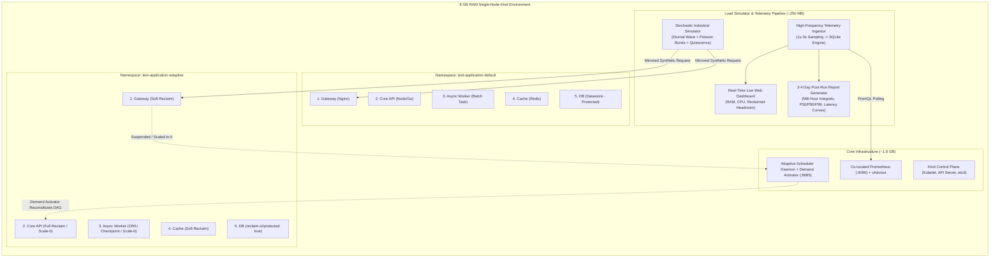
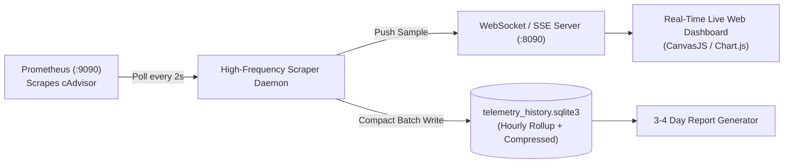
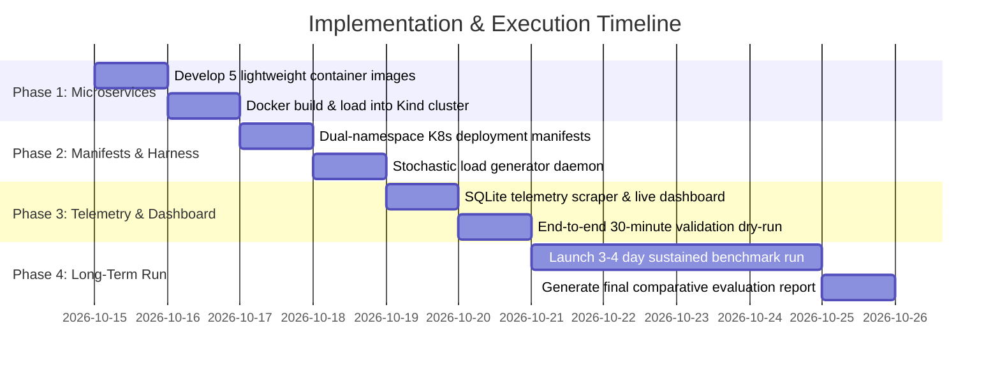

# Implementation Plan: 4-Day Industrial Comparative Testbed & Telemetry Suite
## Adaptive Kubernetes Scheduler vs. Default Kubernetes Scheduler

---

## 1. Executive Summary & Objective

The objective of this project is to build an end-to-end, reproducible **benchmarking testbed** to empirically validate and compare the **Adaptive Kubernetes Scheduler & Runtime Reclamation Controller** against the standard Kubernetes **`default-scheduler`**.

The benchmark will demonstrate that our adaptive scheduler delivers **quantifiable memory efficiency and cluster headroom reclamation** without violating SLAs, over a continuous **3–4 day undisturbed production run** on a single **8 GB RAM host system**.



---

## 2. Strict Memory Sizing & 8 GB RAM Host Budget

To prevent host swapping, Docker daemon crashes, or Linux Out-Of-Memory (`oom-killer`) terminations during a continuous 96-hour run, the memory budget is capped at **< 5.5 GB total peak**, leaving a generous **2.5 GB buffer** for host OS tasks.

| Component / Layer | Count / Instances | Active RAM Footprint | Idle / Reclaimed Footprint | Notes / Constraints |
| :--- | :--- | :--- | :--- | :--- |
| **Windows OS + Docker Desktop Engine** | 1 Host | `2,200 MB` | `2,200 MB` | Base WSL2/Docker VM reservation |
| **Kind Node Control Plane (v1.27+)** | 1 Node | `1,100 MB` | `1,100 MB` | etcd, kube-apiserver, kubelet |
| **Telemetry & Scheduler Stack** | 1 Pod (`2/2`) | `450 MB` | `450 MB` | Prometheus (2d retention, 15s scrape), Adaptive Scheduler |
| **Default Scheduler App (`test-application-default`)** | 5 Pods | `448 MB` | `448 MB` | **Static reservation**: Never yields memory during quiet periods |
| **Adaptive Scheduler App (`test-application-adaptive`)** | 5 Pods | `448 MB` | **`112 MB`** | **Dynamic**: Drops by **75%** when Worker & Core API scale to 0 |
| **Stochastic Load Simulator & Poller** | 1 Process / Pod | `180 MB` | `180 MB` | Go/Node async client + SQLite writer |
| **Total Host Memory Consumption** | — | **`4,826 MB`** | **`4,490 MB`** | **Peak headroom remaining: ~3.2 GB** |

---

## 3. The 5-Container Microservices Test Application

The test application represents a real-world multi-tier industrial IoT / Fleet Logistics architecture:

### 1. `gateway` (API Gateway & Ingress Router)
* **Function**: Ingress proxy routing traffic, authenticating JWT tokens, and rate-limiting.
* **Technology**: Nginx Alpine or lightweight Go reverse proxy.
* **Resources**: `requests: {cpu: "30m", memory: "32Mi"}`, `limits: {cpu: "150m", memory: "64Mi"}`.
* **Adaptive Policy**: `scheduler.reclaim/class: "A"`, `reclaim.io/checkpointable: "false"`, `reclaim.io/graceful-redeploy: "false"`. Soft reclaimable only.

### 2. `core-api` (Core Business & Telemetry API)
* **Function**: Accepts telemetry ingestion, calculates route dispatches, queries cache/database.
* **Technology**: Go 1.24 HTTP server or Node.js lightweight runtime.
* **Resources**: `requests: {cpu: "50m", memory: "64Mi"}`, `limits: {cpu: "250m", memory: "128Mi"}`.
* **Adaptive Policy**: `scheduler.reclaim/class: "B"`, `reclaim.io/checkpointable: "true"`, `reclaim.io/graceful-redeploy: "true"`, `reclaim.io/depends-on: "cache,datastore"`. Full reclaimable (scales to 0 during idle phases; buffered by Demand Activator).

### 3. `batch-worker` (Async Heavy Processing Worker)
* **Function**: Consumes queued batch jobs (e.g., GPS track compression, report generation, route graph optimization). High memory spikes during active jobs, long idle quiescence between runs.
* **Technology**: Python 3.11 / Go worker polling tasks from `cache`.
* **Resources**: `requests: {cpu: "50m", memory: "64Mi"}`, `limits: {cpu: "300m", memory: "192Mi"}`.
* **Adaptive Policy**: `scheduler.reclaim/class: "C"`, `reclaim.io/checkpointable: "true"`, `reclaim.io/graceful-redeploy: "true"`. Prime candidate for CRIU container checkpointing and scale-to-zero.

### 4. `cache` (Fast In-Memory Layer)
* **Function**: Telemetry buffering, session cache, worker task queue.
* **Technology**: Redis 7 Alpine.
* **Resources**: `requests: {cpu: "20m", memory: "32Mi"}`, `limits: {cpu: "100m", memory: "64Mi"}`.
* **Adaptive Policy**: `scheduler.reclaim/class: "B"`, `reclaim.io/protected: "false"`. Soft in-place right-sizing only.

### 5. `datastore` (Persistent Storage Engine)
* **Function**: Master audit log, transaction history, vehicle metadata.
* **Technology**: PostgreSQL 16 Alpine or SQLite REST daemon with PersistentVolumeClaim.
* **Resources**: `requests: {cpu: "40m", memory: "64Mi"}`, `limits: {cpu: "200m", memory: "128Mi"}`.
* **Adaptive Policy**: `scheduler.reclaim/class: "A"`, `reclaim.io/protected: "true"`. **Hard safety gate**: Never evicted or scaled to 0.

---

## 4. Stochastic Industrial Traffic Simulator

To replicate industrial workloads over a sustained 3–4 day period, the simulator incorporates three distinct stochastic layers:

```
Traffic Intensity (QPS)
   ▲
40 │              ┌──┐ [Flash Burst]
30 │        ┌─────┘  └──┐
20 │   ┌────┘           └────┐             [Circadian Peak]
10 │  ─┘                     └─┐
 1 │                           └───────────┐ [Night Quiescence / Reclamation Window]
 0 ┼───┴──────┴──────┴──────┴──────┴───────┴──────► Time
     08:00  12:00  16:00  20:00  00:00   04:00
```

### A. Non-Homogeneous Poisson Arrival Process
Request intervals follow an exponential distribution with time-varying arrival rate $\lambda(t)$:
$$P(N(t + \Delta t) - N(t) = k) = \frac{(\lambda(t) \Delta t)^k e^{-\lambda(t) \Delta t}}{k!}$$
Where $\lambda(t)$ oscillates through distinct operational regimes:
1. **Regime 1: Peak Business Hours (10:00 - 18:00)**: $\lambda = 15 - 35 \text{ req/s}$ with random Poisson bursts.
2. **Regime 2: Moderate Evening Wave (18:00 - 23:00)**: $\lambda = 5 - 12 \text{ req/s}$.
3. **Regime 3: Deep Night Quiescence (23:00 - 06:00)**: $\lambda = 0.05 \text{ req/s}$ (1 ping every 20–60s). This provides a prolonged **7-hour daily window** where the Adaptive Scheduler detects genuine multi-signal inactivity and triggers Full Reclaim.
4. **Regime 4: Morning Shock & Restoration (06:00 - 08:00)**: Sudden traffic surge to test Demand Activator request buffering, DAG-ordered reactivation (`cache/datastore` $\to$ `core-api`), and zero dropped packets.

### B. Weighted Endpoint Distribution
* **60% Light Reads**: `GET /api/v1/fleet/status` (Cache & Gateway).
* **25% State Transactions**: `POST /api/v1/telemetry/record` (Core API & DB).
* **15% Heavy Batch Jobs**: `POST /api/v1/jobs/aggregate-history` (Pushes high-RAM job to Batch Worker).

### C. Deterministic Dual Mirroring
Every generated session sends **two identical requests in parallel**:
* `Client -> Gateway (http://gateway.test-application-default.svc:80)`
* `Client -> Gateway (http://gateway.test-application-adaptive.svc:80)`
This guarantees identical input vectors, eliminating traffic discrepancy bias.

---

## 5. Real-Time Telemetry & Long-Duration Storage Pipeline



### High-Frequency Metric Queries (PromQL)
1. **Per-Namespace Working Set Memory (MB)**:
   ```promql
   sum(container_memory_working_set_bytes{namespace="test-application-adaptive", container!="", container!="POD"}) / (1024 * 1024)
   ```
2. **Per-Namespace CPU Rate (Millicores)**:
   ```promql
   sum(rate(container_cpu_usage_seconds_total{namespace="test-application-adaptive", container!="", container!="POD"}[1m])) * 1000
   ```
3. **Host Physical Available Memory (MB)**:
   ```promql
   node_memory_MemAvailable_bytes / (1024 * 1024)
   ```
4. **Live Replicas & Reclamation State**:
   Tracked directly via Kubernetes API informers (`ReadyReplicas`).

### Storage Optimization for 96-Hour Continuity
* Sampling at **2-second intervals** produces $43,200 \text{ points/day} \times 4 \text{ days} = 172,800$ rows.
* Storing in SQLite with integer timestamps and float32 metrics consumes **< 35 MB total disk space**, preventing disk bloating.

---

## 6. Real-Time Visualization Dashboard Specifications

A single-page, real-time web dashboard running on `http://localhost:8090`:
* **Card 1: Real-Time Memory Comparison**: Dual-line graph showing Default Scheduler RAM (flat/high line) vs. Adaptive Scheduler RAM (dynamic, valleys during night quiescence).
* **Card 2: CPU Millicores Allocation**: Demonstrates CPU throttling during soft reclaim and idle phases.
* **Card 3: Cluster Physical Free Headroom**: Live counter showing extra megabytes unlocked on the node by our scheduler.
* **Card 4: Workload State Matrix**: Real-time badges for all 10 containers (`ACTIVE`, `SOFT_THROTTLED`, `CHECKPOINTED`, `SCALED_TO_ZERO`).
* **Card 5: Traffic QPS Gauge**: Live incoming requests/sec from the stochastic generator.

---

## 7. Post-Test Analysis & 3–4 Day Validation Report

When the 3–4 day experiment concludes, `generate_comparison_report.py` executes to process the full dataset and generate:

### A. Mathematical Metrics
1. **Cumulative Memory Integral ($\text{MB}\cdot\text{Hours}$ Reclaimed)**:
   $$\Delta M_{\text{saved}} = \int_{0}^{T} \left[ M_{\text{default}}(t) - M_{\text{adaptive}}(t) \right] dt$$
   Quantifies total memory capacity returned to the cluster pool.
2. **Memory Footprint Percentiles ($P_{50}, P_{90}, P_{99}$)**:
   Side-by-side table showing typical, peak, and idle consumption.
3. **Node Density Factor Gain ($\rho_{\text{gain}}$)**:
   $$\rho_{\text{gain}} = \frac{\text{Workloads Scheduled with Adaptive}}{\text{Workloads Schedulable with Static Requests}} - 1.0$$
4. **Demand Activator Latency Impact**:
   CDF (Cumulative Distribution Function) comparing response times during warm state vs. wake-from-zero reconstitution state.

### B. Artifact Outputs
* `scheduler_longterm_benchmark_report.md`: Formal technical findings, executive summary, and mathematical analysis.
* `benchmark_memory_timeline_96h.png`: High-resolution dual-line chart showing all 4 days with highlighted night reclamation phases.
* `benchmark_cdf_latency.png`: Latency CDF proving zero packet loss and minimal reconstitution overhead.

---

## 8. Implementation Roadmap & Execution Checklist



### Action Items
- [ ] **Step 1**: Write container code for the 5 microservices (`gateway`, `core-api`, `batch-worker`, `cache`, `datastore`) optimized for < 64MB baseline.
- [ ] **Step 2**: Generate Kubernetes YAML specs for `test-application-default` and `test-application-adaptive` (with correct `reclaim.io/*` annotations).
- [ ] **Step 3**: Implement `simulator/traffic_generator.go` (or Python) featuring Diurnal Poisson traffic and dual-mirroring.
- [ ] **Step 4**: Build `telemetry/collector.py` + real-time WebSocket dashboard on `:8090`.
- [ ] **Step 5**: Execute dry-run test (1 hour) to verify metric recording, idle detection, reclamation, and scale-from-zero reactivation.
- [ ] **Step 6**: Launch long-term background benchmark run (72–96 hours) and generate the formal report.
