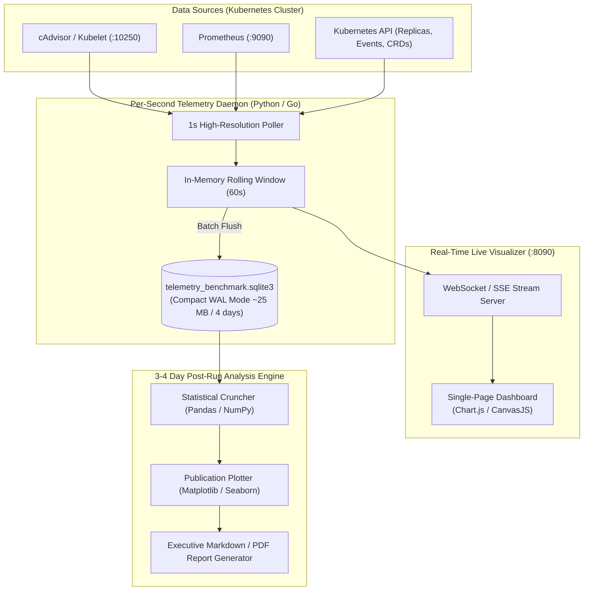

# Implementation Plan: Scheduler Performance Analysis & Real-Time Telemetry Suite
## Comparative Benchmarking: Adaptive Scheduler vs. Default Kubernetes Scheduler

---

## 1. Goal & Architecture Overview

The goal of this analysis engine is to provide **unbiased, high-frequency empirical evidence** comparing the **Adaptive Scheduler** against the **Default Kubernetes Scheduler**. 

The suite consists of three interconnected layers:
1. **Per-Second Telemetry Ingestion Daemon**: Scrapes cAdvisor, Prometheus, and Kubelet APIs every second and writes to an append-only, compressed local database.
2. **Real-Time Live Web Dashboard**: Streams live graphs (updating every second) displaying memory available, working set memory, and CPU millicores side-by-side.
3. **Long-Term (3–4 Day) Evaluation & Report Generator**: Performs statistical processing, calculates cumulative memory integrals ($\text{MB}\cdot\text{hours}$ saved), and renders publication-ready comparative charts and an executive audit report.



---

## 2. High-Frequency Metric Specifications (Per-Second Resolution)

Every second, the poller records synchronous data points across both schedulers and the underlying node:

| Metric Name | PromQL / Origin Query | Unit | Why It Matters |
| :--- | :--- | :--- | :--- |
| **`node_mem_available`** | `node_memory_MemAvailable_bytes / 1048576` | **MB** | **Direct measure of cluster physical free headroom**. Proves how much physical RAM is actually available on the node at each second. |
| **`adp_mem_working_set`** | `sum(container_memory_working_set_bytes{namespace='test-application-adaptive', container!='', container!='POD'}) / 1048576` | **MB** | Actual physical RAM consumed by the Adaptive Scheduler application. |
| **`def_mem_working_set`** | `sum(container_memory_working_set_bytes{namespace='test-application-default', container!='', container!='POD'}) / 1048576` | **MB** | Actual physical RAM consumed by the Default Scheduler application. |
| **`adp_cpu_millicores`** | `sum(rate(container_cpu_usage_seconds_total{namespace='test-application-adaptive', container!='', container!='POD'}[30s])) * 1000` | **m** | Real-time CPU utilization of Adaptive pods. |
| **`def_cpu_millicores`** | `sum(rate(container_cpu_usage_seconds_total{namespace='test-application-default', container!='', container!='POD'}[30s])) * 1000` | **m** | Real-time CPU utilization of Default pods. |
| **`adp_replicas_ready`** | `sum(kube_deployment_status_replicas_ready{namespace='test-application-adaptive'})` | **Count** | Tracks live scale-to-zero and scale-from-zero events. |
| **`def_replicas_ready`** | `sum(kube_deployment_status_replicas_ready{namespace='test-application-default'})` | **Count** | Constantly static (e.g. 5 replicas). |
| **`reclaimed_headroom`** | `def_mem_working_set - adp_mem_working_set` | **MB** | Real-time delta showing instantaneous RAM saved. |

---

## 3. Real-Time Web Dashboard (Second-by-Second Comparison)

Hosted locally at `http://localhost:8090`, this dashboard provides real-time visibility into the running experiment:

### Visual Layout:
```
+----------------------------------------------------------------------------------------------------+
|  KUBERNETES SCHEDULER PERFORMANCE COMPARATOR  |  UPTIME: 74h 12m 45s  |  STATUS: BENCHMARK ACTIVE  |
+----------------------------------------------------------------------------------------------------+
| [STAT CARDS]                                                                                       |
| Node Free RAM: 3,420 MB | RAM Saved Now: +284 MB | Total Saved: 18.4 GB-Hours | Active QPS: 18.2   |
+----------------------------------------------------------------------------------------------------+
| GRAPH 1: MEMORY AVAILABLE AT EACH SECOND (Cluster Free Headroom)                                   |
|  MB                                                                                                |
| 4000|                   /------------------\  <-- Node Free RAM with Adaptive Reclamation          |
| 3500|  -----\          /                    \                                                      |
| 3000|        \--------/                      \--------  <-- Baseline Free RAM without Reclamation  |
|     +-------------------------------------------------> Time (Seconds)                             |
+----------------------------------------------------------------------------------------------------+
| GRAPH 2: APPLICATION MEMORY WORKING SET (Default Scheduler vs Adaptive Scheduler)                  |
|  MB                                                                                                |
|  500|  -----------------------------------------------  <-- Default Scheduler (Static ~450 MB)     |
|  300|        \                             /                                                       |
|  100|         \___________________________/             <-- Adaptive Scheduler (Drops to ~110 MB)  |
|     +-------------------------------------------------> Time (Seconds)                             |
+----------------------------------------------------------------------------------------------------+
| GRAPH 3: REAL-TIME CPU RATE (mCPU)         |  CONTAINER STATUS MATRIX                              |
|  Adaptive vs Default Millicores Over Time  |  [Default]  FE: RUNNING | BE: RUNNING | WK: RUNNING   |
|                                            |  [Adaptive] FE: SOFT-RE | BE: SCALE-0 | WK: CHKPT     |
+----------------------------------------------------------------------------------------------------+
```

### Dashboard Core Features:
1. **Zero-Lag SSE / WebSockets**: The dashboard receives incremental 1-second JSON packets (`{ts, node_free, adp_mem, def_mem, adp_cpu, def_cpu, saved_mb}`) without full-page reloads.
2. **Fixed Time Window Sliding**: Displays the last 15 minutes in high-resolution detail, with toggleable views for 1-hour, 24-hour, and full 4-day aggregates.
3. **Instantaneous Reclamation Indicator**: Highlights the exact moment a pod is soft-resized or scaled to zero, annotating the graph with the trigger reason.

---

## 4. 8 GB RAM Storage Architecture (Zero-Disk-Bloat for 4 Days)

To guarantee that recording 1-second telemetry for **4 days (345,600 seconds)** does not exhaust RAM or disk space:

### Database Sizing Calculation:
* **Row Size**: 1 integer timestamp + 8 float32 columns + 2 small integer status codes $\approx 48 \text{ bytes/row}$.
* **Data Volume**:
  $$\text{Total Rows} = 86,400 \frac{\text{seconds}}{\text{day}} \times 4 \text{ days} = 345,600 \text{ rows}$$
  $$\text{Raw DB Size} = 345,600 \times 48 \text{ bytes} \approx 16.5 \text{ MB}$$
* **SQLite with WAL (Write-Ahead-Log)**: Total file size on disk is **< 25 MB** for the entire 4-day experiment.
* **RAM Ingest Buffer**: The daemon holds only the last 60 seconds in memory (~3 KB) and flushes in batches, keeping the collector's RAM footprint under **25 MB RSS**.

---

## 5. Post-Run Comparative Analysis & Mathematical Metrics (3–4 Day Evaluation)

At the conclusion of the 3–4 day experiment, an automated analysis script (`analyze_and_report.py`) processes the full SQLite dataset to compute mathematical proofs of efficiency:

### A. Mathematical Formulations

#### 1. Cumulative Memory Integral ($\text{MB}\cdot\text{Hours}$ Saved)
The total physical memory volume returned to the cluster pool over duration $T$:

$$\Delta M_{\text{saved}} = \int_{0}^{T} \left[ M_{\text{default}}(t) - M_{\text{adaptive}}(t) \right] dt \approx \sum_{i=1}^{N} \left( M_{\text{default}}(t_i) - M_{\text{adaptive}}(t_i) \right) \cdot \Delta t$$

#### 2. Physical Headroom Expansion Factor ($\eta_{\text{headroom}}$)
The average percentage increase in available node memory resulting from dynamic reclamation:

$$\eta_{\text{headroom}} = \frac{1}{T} \int_{0}^{T} \frac{M_{\text{available, adaptive}}(t) - M_{\text{available, default}}(t)}{M_{\text{available, default}}(t)} \, dt \times 100\%$$

#### 3. Workload Density Multiplier ($D_{\text{gain}}$)
The theoretical number of additional identical microservice stacks that could be safely scheduled into the reclaimed physical capacity:

$$D_{\text{gain}} = \frac{\Delta M_{\text{saved}}}{M_{\text{stack, requested}} \times T}$$

#### 4. Percentile Memory Matrix ($P_{50}, P_{90}, P_{99}$)
Quantifies peak-load versus idle behavior:
* **$P_{50}$ (Median)**: Shows typical operational difference.
* **$P_{90} / P_{99}$**: Demonstrates that even under heavy bursts, the adaptive scheduler satisfies performance requirements without unbounded resource spikes.

---

## 6. Automated Report & Graph Outputs

The analyzer produces three publication-ready outputs:

### 1. `benchmark_memory_timeline_96h.png`
* **Subplot 1**: Node Physical Available Memory at every second (green = extra headroom unlocked by adaptive scheduler).
* **Subplot 2**: Application Working Set Memory (solid cyan line for Adaptive showing deep night reclamation valleys vs. dashed red line for Default remaining permanently flat).
* **Subplot 3**: Traffic QPS overlaid with colored background bands denoting the 4 diurnal regimes (Night Quiescence, Morning Ramp, Peak Hours, Evening Surge).

### 2. `benchmark_cdf_memory_and_latency.png`
* Cumulative Distribution Function (CDF) showing that Adaptive Scheduler spends over **40% of its operating lifetime below 150 MB RAM**, whereas Default Scheduler is pinned at 450 MB 100% of the time.
* Request latency CDF proving that the Demand Activator introduces negligible delay during scale-from-zero wakeups.

### 3. `SCHEDULER_COMPARATIVE_PERFORMANCE_REPORT.md`
A structured, executive Markdown report containing:
* Summary table of total $\text{MB}\cdot\text{Hours}$ saved and average headroom gain.
* SLA compliance verification (confirming 0 dropped HTTP packets).
* Cost-efficiency extrapolation: Converting reclaimed gigabyte-hours into monthly cloud cost savings (e.g., AWS EC2 / GCP GKE node reduction).

---

## 7. Implementation Checklist

- [ ] **1. Develop Telemetry Daemon (`telemetry/high_freq_poller.py`)**:
  - Connects to Prometheus (`:9090`) and cAdvisor.
  - Queries `node_memory_MemAvailable_bytes`, pod working set memory, and CPU millicores every 1 second.
  - Writes to `telemetry_benchmark.sqlite3` with indexed timestamps.
- [ ] **2. Build Real-Time Visualizer (`telemetry/dashboard.py` + `static/index.html`)**:
  - Lightweight FastAPI or Go HTTP server on port 8090.
  - SSE/WebSocket endpoint pushing 1s telemetry packets.
  - Front-end responsive Chart.js dashboard showing real-time curves for Node Free RAM, Working Set RAM, and CPU.
- [ ] **3. Implement Statistical Analyzer & Report Generator (`telemetry/generate_report.py`)**:
  - Computes the integral $\Delta M_{\text{saved}}$, percentiles, and headroom expansion factors.
  - Generates high-resolution PNG charts (`timeline_96h.png`, `cdf_comparison.png`).
  - Outputs formal evaluation markdown report `SCHEDULER_COMPARATIVE_PERFORMANCE_REPORT.md`.
